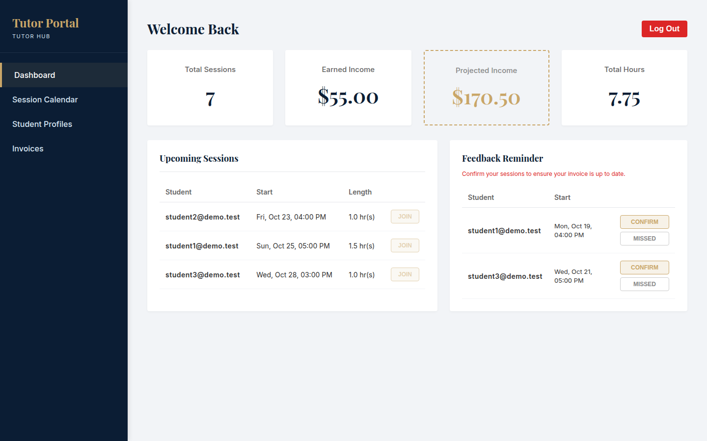
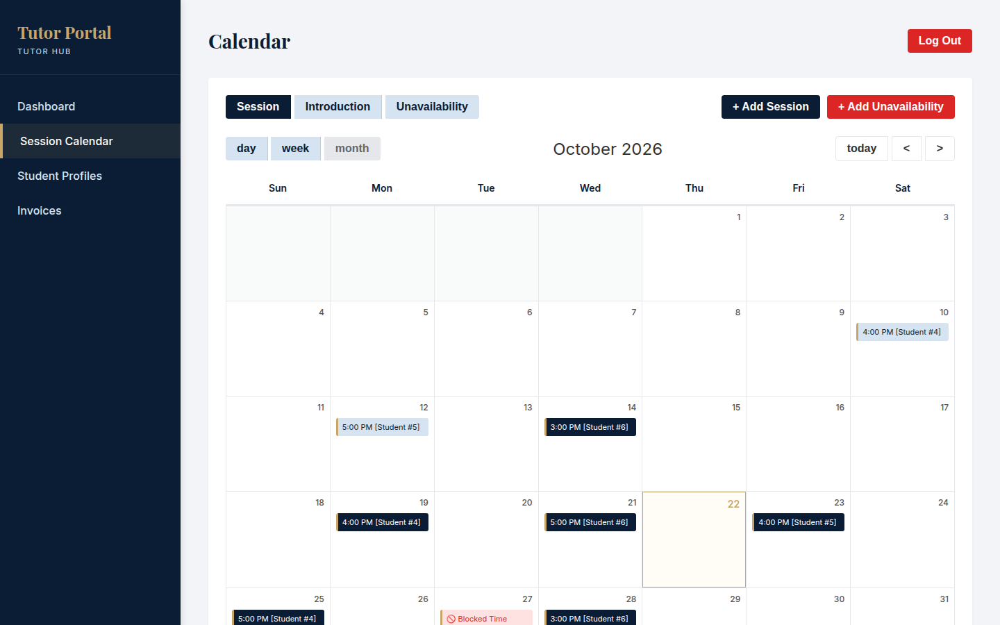
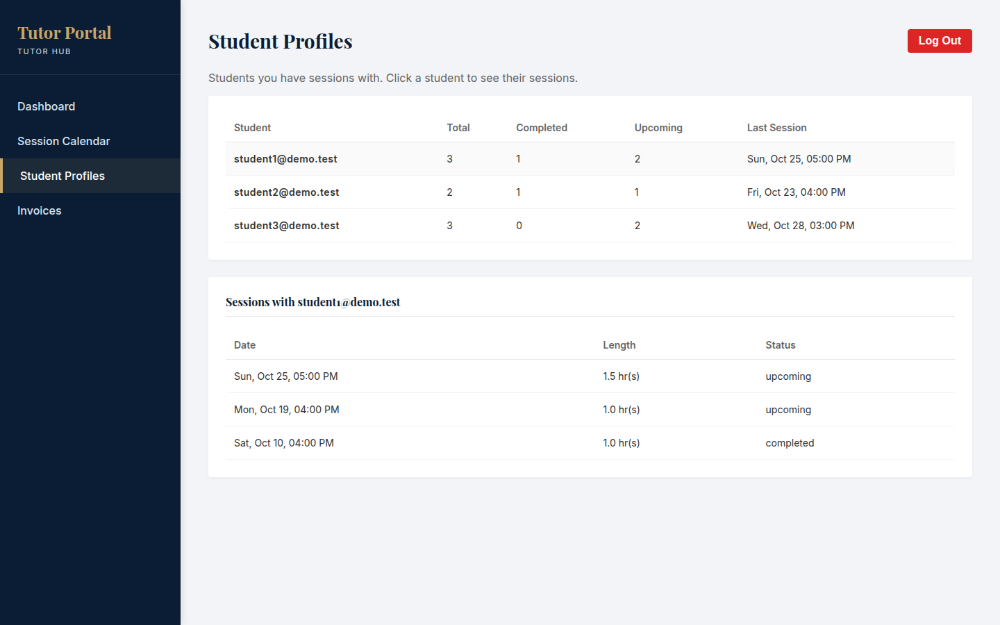
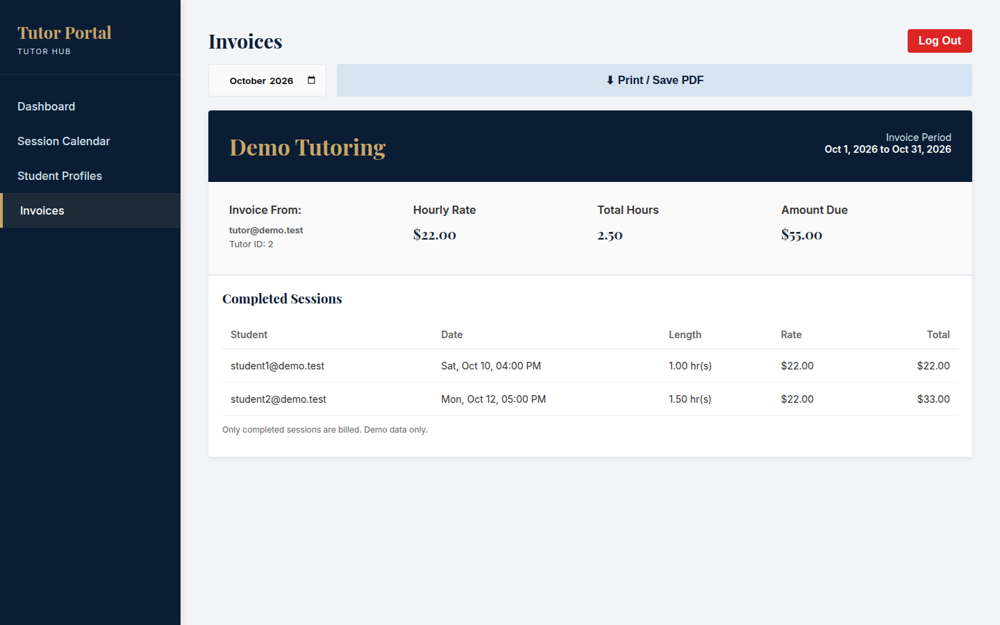
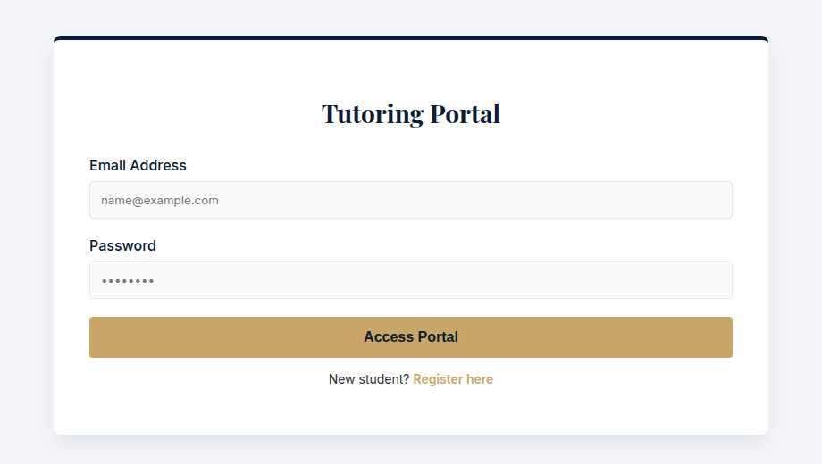
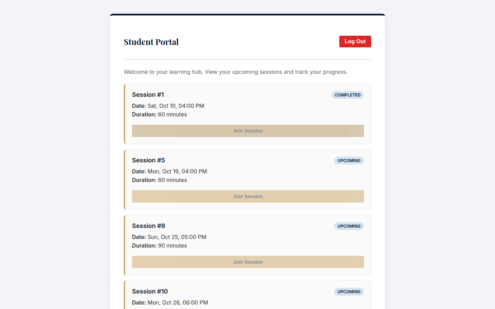
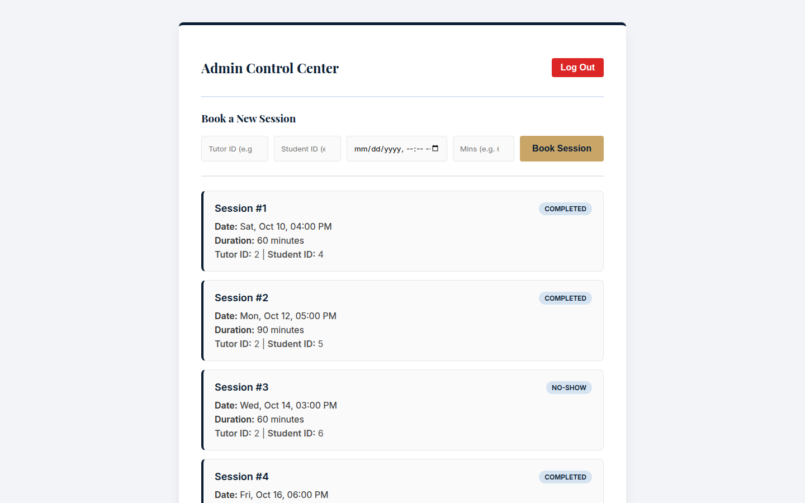

# Northline Tutoring: Portal Demo

A full-stack, role-based tutoring management portal. Students, tutors, and admins each log in to their own dashboard, backed by a secured REST API and a MySQL database.

> **About this repo:** This is the **public demo version** of the Northline Tutoring portal, a client product I designed, built, and maintain. The production code is private. This copy contains **no sensitive information**: no credentials or secrets, no real user, student, or business data, and no production URLs. It runs entirely on fake seed data, while keeping the same architecture and features as the real system.

## Screenshots

**Tutor dashboard.** Income and hours at a glance, with sessions split into upcoming and awaiting feedback.



**Session calendar.** Month view with colour-coded sessions and blocked time.



| Student profiles | Invoices |
|---|---|
|  |  |

| Login | Student portal | Admin control center |
|---|---|---|
|  |  |  |

## Features

**Tutors**
- Dashboard with total sessions, hours, earned income (completed sessions) and projected income (upcoming sessions)
- Sessions automatically split into *Upcoming* and *Needs feedback* based on the current time
- One-click marking of past sessions as completed or no-show
- Interactive month-view calendar with colour-coded sessions and blocked time
- Modal forms to book sessions and block out unavailability

**Students**
- Personal dashboard showing their own sessions
- Self-registration (always creates a student account)

**Admins**
- Master view of every session across all tutors
- Book sessions for any tutor and student
- Create tutor and admin accounts

**Student Profiles**
- Tutors see every student they have sessions with (admins see all students), with total, completed and upcoming session counts and the last session date
- Click a student to see all your sessions with them

**Invoices**
- Monthly invoice built from completed sessions only, using the same hourly rate as the dashboard income cards
- Pick any month, and print or save it as a PDF

## Tech stack

| Layer | Tech |
|---|---|
| Frontend | HTML5, CSS3 (Grid, Flexbox, custom properties, print styles), vanilla JavaScript (Fetch API, single-page view switching) |
| Backend | Node.js, Express 5 |
| Database | MySQL (via `mysql2` with a connection pool) |
| Auth | bcrypt password hashing, JWT (2-hour expiry) |
| Validation | Joi |
| Security | helmet (security headers), express-rate-limit |

## Security

- Passwords hashed with bcrypt; never stored or returned in plain text
- JWT authentication on every protected route, with role checks (`admin`, `tutor`, `student`) enforced **on the server**, not just in the UI
- Public sign-up can only create student accounts. The role field is ignored, so nobody can register as an admin
- Tutors can only see, edit, and delete their own sessions; requests for other tutors' sessions return 404
- Tutors can't book sessions under another tutor's ID; the server uses the ID from their token
- All request bodies validated with Joi; unknown fields are stripped
- Every SQL query is parameterized to prevent SQL injection
- CORS restricted to an allow-list of frontend origins
- Login and sign-up are rate limited (20 attempts per 15 minutes per IP), and helmet sets standard security headers
- The Student Profiles endpoint never returns password hashes, and tutors only ever see their own students
- Text from the database is escaped before it is shown on the page, so typed HTML can't run
- Login returns the same error for a wrong email or wrong password, so registered emails can't be discovered
- Secrets live in `.env`, which is git-ignored; internal errors are logged on the server and never sent to the client

## Architecture

```
Browser (vanilla JS SPA)
   │  fetch() + JSON, Authorization: Bearer <JWT>
   ▼
Express API ── verifyToken ── requireRole ── Joi validation ── route handler
   │
   ▼
MySQL (users, sessions)
```

## API

| Method | Endpoint | Access | Description |
|---|---|---|---|
| POST | `/auth/register` | Public | Create a student account |
| POST | `/auth/login` | Public | Log in, returns a JWT and the user's role |
| GET | `/users` | Admin | List all users |
| POST | `/users` | Admin | Create a user with any role |
| GET | `/sessions` | Logged in | Admin: all sessions. Tutor/student: only their own |
| POST | `/sessions` | Admin, tutor | Book a session or block time |
| PUT | `/sessions/:id` | Admin, own tutor | Update status, rating, or feedback (only the fields sent) |
| DELETE | `/sessions/:id` | Admin, own tutor | Delete a session |
| GET | `/students` | Admin, tutor | Student profiles with session counts. Tutor: only their own students |
| GET | `/health` | Public | Health check |

## Running it locally

**Requirements:** Node.js 18+ and MySQL 8+ (or MariaDB).

```bash
# 1. Backend
cd backend
npm install
cp .env.example .env        # then fill in your DB details and a JWT_SECRET
npm run db:setup            # creates the database and tables
npm run seed                # adds fake demo users and sessions
npm start                   # API on http://localhost:5000

# 2. Frontend (in a second terminal)
cd frontend
npx serve -l 8080 .         # or: python3 -m http.server 8080
```

Open http://localhost:8080. If your API runs somewhere else, change `API_URL` in `frontend/config.js` and add your frontend's address to `CORS_ORIGIN` in `.env`.

### Demo accounts

All use the password `DemoPass123!` (local demo data only).

| Role | Email |
|---|---|
| Admin | `admin@demo.test` |
| Tutor | `tutor@demo.test` |
| Student | `student1@demo.test` |

## Project structure

```
backend/
  server.js              entry point
  src/app.js             Express app, CORS, error handling
  src/db.js              MySQL connection pool
  src/middleware/auth.js JWT verification and role checks
  src/validation.js      Joi schemas
  src/routes/            auth, users, sessions
  db/schema.sql          database schema
  scripts/               DB setup and seed scripts
frontend/
  index.html, app.js, style.css, config.js
```

## What I'd improve next

- Meeting links for the Join buttons
- Automated API tests (Jest + Supertest)
- Move the JWT from localStorage to an httpOnly cookie
